# Zero-Cost SaaS Affiliate Automation Engine

An open-source, zero-monthly-cost marketing automation architecture designed for developers, technical creators, and digital product builders. Replaces expensive monthly subscriptions ($150+/mo for ClickFunnels, ActiveCampaign, or Teachable) with a clean, automated lead-capture, email-nurturing, and conversion funnel powered by **systeme.io**.

---

## 🎯 Architecture Overview

```mermaid
flowchart LR
    A[Organic Traffic: GitHub / Pinterest / Dev.to] --> B[High-Converting Lead Magnet Squeeze Page]
    B --> C[Systeme.io Webhook Trigger]
    C --> D[Day 0: Instant Digital Asset Delivery]
    D --> E[Day 1: Technical Breakdown & Case Study]
    E --> F[Day 2: The Tool Consolidation Framework]
    F --> G[Day 3: SaaS Ecosystem Upgrade & Conversion]
    G --> H[Recurring Commission / Gumroad Product Sale]
```

---

## 🛠️ Complete 4-Part Email Autoresponder Sequence

### Day 0: The Instant Asset Delivery
**Subject:** [Download Inside] Your Production Freelancer Kit is ready  
**Body:**  
> Hey there,  
>  
> Thank you for grabbing the **Freelancer Scope to Cash Starter Blueprint**.  
> Your resource download is ready below:  
> 🔗 **[Click here to access your Blueprint]**  
>  
> This toolkit was engineered to eliminate scope creep and unpaid revisions.  
> Tomorrow, I'll share the exact 3 clauses top contractors use to protect their billing.  
>  
> Talk soon,  
> Mhamed Askoure  

---

### Day 1: The Technical Case Study
**Subject:** Case study: How scope creep destroyed a $4,500 project (and how to fix it)  
**Body:**  
> Ever had a client ask "Can you just tweak this one quick thing?"  
> 14 days later, you’re 40 hours into unbilled work.  
>  
> In this brief breakdown, we dissect how a structured **Scope of Work (SOW)** contract and milestone gating prevented 32 hours of free labor on a real client deliverable.  
>  
> If you haven't implemented automated milestone tracking yet, you can set it up inside your client portal in under 10 minutes.  

---

### Day 2: The Tool Consolidation Framework (Zero Cost)
**Subject:** Why paying $200/mo for marketing tools as a solo developer is broken  
**Body:**  
> Most solo developers and freelancers bleed $150 to $300 every month on:  
> - Landing page builder: $49/mo  
> - Email autoresponder: $79/mo  
> - Course / digital asset hosting: $99/mo  
>  
> You don't need any of that. We consolidated the entire stack into a single, permanent free-tier engine with zero recurring fees up to 2,000 active contacts.  
>  
> 👉 **[Create your zero-cost systeme.io account here]**  

---

### Day 3: The Automated Ecosystem Upgrade
**Subject:** The 1-click marketing funnel blueprint (free template import)  
**Body:**  
> Running your online products or freelance lead generation shouldn't feel like maintaining legacy infrastructure.  
>  
> With this 1-click template, your squeeze page, tag triggers, and 4-part email sequences deploy in under 3 minutes.  
>  
> 🔗 **[Import the Free Funnel Template on Systeme.io](https://systeme.io/?sa=sa02409744111320cf3e839e92fa07b489d81d4b)**  

---

## ⚖️ FTC & Transparency Disclosure
This repository contains affiliate referral links. If you register or purchase a paid plan through these links, we may receive a commission at no additional cost to you. We exclusively recommend platforms and tools that we actively test, deploy, and benchmark in production environments.

---

## 🔗 Related Resources & Productized Services
- 💼 **PostgreSQL Production Benchmark:** [postgresql-query-optimization-benchmark](https://github.com/zongsm-cmyk/postgresql-query-optimization-benchmark)
- 🚀 **Python API & LLM Reliability Rescue ($95):** [Gumroad Productized Service](https://mhamedasskoure.gumroad.com/l/python-api-llm-failover-setup)
- 🛒 **Official Creator Store:** [ALFAROUQ Digital Solutions](https://mhamedasskoure.gumroad.com)

*Maintained by Mhamed Askoure (`zongsm-cmyk`)*
